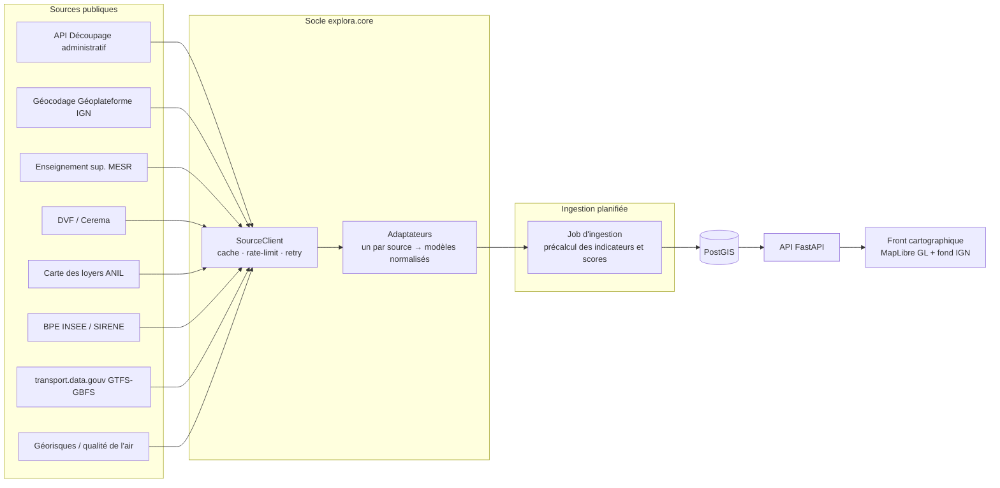

# Explora

**Explorateur de données publiques françaises**, pensé en modules sur un socle commun.

Premier module : **villes étudiantes** (nom définitif à choisir). Il aide parents et
investisseurs à juger si une ville est vivante et abordable pour un étudiant, à partir
d'environ 400 villes disposant d'au moins une formation post-bac.

> Outil indépendant. Les loyers sont des estimations à la commune, pas au quartier.
> Le rendement locatif affiché est indicatif et ne constitue pas un conseil en investissement.

## Architecture



- **Socle** (`src/explora/core`) : un `SourceClient` HTTP commun (cache TTL, limiteur de
  débit token bucket, retry avec backoff exponentiel et respect de `Retry-After`) et le
  contrat `SourceAdapter` : chaque adaptateur déclare ses métadonnées (producteur, licence,
  attribution, limites) et renvoie des modèles normalisés (`core/models.py`).
- **Adaptateurs** (`src/explora/adapters`) : un fichier par source.
- **Modules** (`src/explora/modules`) : logique métier réutilisant le socle. Le module
  étudiant contient les indicateurs clés et le score sur 4 axes à pondération réglable.
- **API** (`src/explora/api`) : FastAPI, adaptateurs injectés par dépendance.

## État d'avancement

| Brique | État |
| --- | --- |
| Client HTTP commun, cache, rate-limit, retry | fait, testé |
| Adaptateurs : découpage administratif, géocodage, Géorisques, carte des loyers, vœux Parcoursup, cartographie des formations, résidences étudiantes, INSEE Melodi (BPE, logements) | fait, testé avec API simulées et en réel |
| Indicateurs (rendement, tension, vitalité) et score 4 axes | fait, testé |
| API : `/health`, `/sources`, `/communes/{code_insee}` | fait |
| Adaptateurs effectifs ESR, DVF, SIRENE, GTFS/GBFS, qualité de l'air | à faire |
| Schéma PostGIS et job d'ingestion | à faire |
| Site : carte MapLibre, pondération réglable, une page SEO par ville | maquette, sur données de démo |

Les sources et leurs endpoints sont décrits dans [docs/sources.md](docs/sources.md), la
méthode de sélection des villes dans [docs/selection-villes.md](docs/selection-villes.md)
et les choix techniques dans [docs/adr](docs/adr).

## Démarrer

Prérequis : [uv](https://docs.astral.sh/uv/) et Docker.

```bash
cp .env.example .env
uv sync
uv run pytest                 # tests, toutes les API sont simulées
uv run pytest -m live         # appels réels aux API publiques (réseau requis)
uv run uvicorn explora.api.main:app --reload
# ou, avec PostGIS :
docker compose up --build
```

Puis <http://localhost:8000/docs>.

Qualité : `uv run ruff check . && uv run ruff format --check . && uv run mypy`.

## Site (maquette)

Le site est statique : `explora.site.generer` lit l'export GeoJSON du job d'ingestion
(contrat dans `src/explora/site/donnees.py`) et produit la carte, une page par ville
(« Logement étudiant à [ville] : loyers, prix, vie étudiante »), le sitemap et le
`robots.txt`. La pondération des quatre axes est recalculée dans le navigateur.

```bash
uv run python -m explora.site.generer --sortie dist/site   # données de démo par défaut
python -m http.server -d dist/site 8001                     # puis http://localhost:8001
```

- `web/templates` : gabarits Jinja ; `web/assets` : CSS et JS sans build (MapLibre GL 4.7.1
  et polices chargés depuis unpkg et Google Fonts ; à héberger soi-même avant la mise en
  production, notamment pour les polices).
- `web/data/villes.demo.geojson` : les 400 vraies villes, leurs vrais effectifs et
  formations, et des indicateurs **fictifs** (badge « démo » sur chaque valeur, pages en
  `noindex`). Régénération : `uv run python -m explora.site.demo`.
- `web/data/formations.json` : les ~22 000 formations post-bac (session 2026) des villes,
  données **réelles** de la cartographie des formations du MESR. Elles alimentent la
  recherche par formation sur la carte et la liste des formations de chaque fiche ville.
  Régénération : `uv run python -m explora.site.formations`.
- Fond de carte : Plan IGN (Géoplateforme, WMTS), désaturé.
- Démo publiée par `.github/workflows/pages.yml` à chaque merge sur `main`
  (activer Settings > Pages > Source « GitHub Actions »).

## Contribuer

La branche `main` est protégée : toute modification passe par une pull request validée
par la CI. Aucun secret n'est commité (`.env` est ignoré, voir `.env.example`).

## Données et licences

Les données proviennent de producteurs publics, principalement sous Licence Ouverte 2.0.
L'endpoint `/sources` liste pour chaque source sa licence et la mention d'attribution à
afficher.

## Licence

[MIT](LICENSE)
